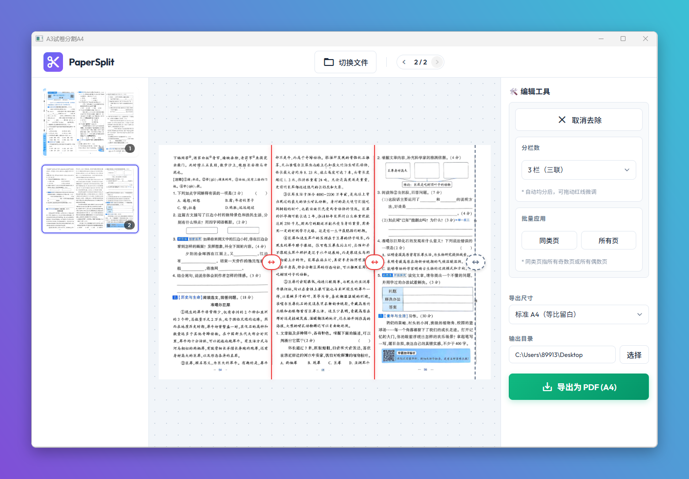

# A3试卷分割A4

> 把 A3 试卷 / 文档一键拆分成 A4。原项目 [PaperSplit](https://github.com/TwoBall/PaperSplit) 是一个**需要自己部署**的纯网页工具；本版本已接入「不忙脚本盒子」，改造成**可直接在电脑桌面运行的 GUI 工具**——右键试卷即开、一键把结果写盘，**无需部署、无需打开浏览器**。

---

## 🖥️ 从网页工具到桌面工具

PaperSplit 原本是一个纯前端网页项目：需要自己安装 Node、构建并托管前端服务，然后在浏览器里打开，文件在浏览器中处理、结果靠浏览器下载。

本脚本把它封装进了「不忙脚本盒子」，变成一个随点随用的桌面小工具：

| 维度 | 原项目（网页） | 本版本（盒子桌面工具） |
| --- | --- | --- |
| 打开方式 | 自建/部署 Web 服务，浏览器打开 | 右键试卷 / 快捷键 / 卡片，桌面窗口直接打开 |
| 环境依赖 | 自行安装 Node、构建与托管前端 | 盒子自动准备运行环境，**无需手动部署** |
| 输入 | 在网页里手动拖拽上传 | 右键选中文件自动载入，也可在窗口内选择 |
| 导出 | 浏览器下载到默认下载目录 | 直接写盘到你指定的目录，并记住上次选择 |
| 数据隐私 | 全程浏览器本地 | 全程本机本地（本地服务 + 本地窗口），不上传 |

> 日常使用只需三步：装好盒子 → 选中 A3 试卷右键「A3试卷分割A4」→ 调好分割线并导出。

---

## 核心特性

- **智能导入**：右键选中 A3 PDF 或图片即可打开；卡片启动时也可在窗口内手动选文件。
- **多栏分割**：支持二联 / 三联 / 四联，选择「分栏数」自动均分，再拖动红色分割线微调。
- **可视化分割**：拖动红色分割线，自由设定各栏的切分位置。
- **密封线去除**：一键开启密封线区域，奇数页默认靠左、偶数页默认靠右，导出时自动裁掉。
- **批量应用**：把当前配置一键应用到「同类页」（所有奇数页 / 偶数页）或「所有页」。
- **多种 A4 导出**：标准 A4（等比留白）/ 标准 A4（拉伸填满）/ 原始裁剪尺寸（所见即所得）。
- **可设输出目录**：窗口内选择导出目录并记住上次选择；不选则保存到源文件同目录。
- **高清导出**：2 倍分辨率渲染，导出高质量 A4 PDF，自动保存为 `原文件名(A4).pdf`。

---

## 脚本演示

---

## 安装方法

本脚本的运行环境、依赖组件及图形化窗口均依赖「不忙脚本盒子」，建议仅通过盒子安装和使用本脚本。

> 前置条件：安装好 [不忙脚本盒子](https://www.bm-box.cn)

* 打开盒子 → **脚本市场** → 搜索 **「A3试卷分割A4」**
* 点击「安装」

---

## 使用方式

### 右键启动（推荐）

* 在文件管理器中选中一个 A3 试卷文件（`.pdf` / `.jpg` / `.jpeg` / `.png`）
* 右键 → 选择「A3试卷分割A4」
* 窗口自动打开并载入该文件的第 1 页

### 快捷键启动

* 在盒子中为脚本设置全局快捷键
* 选中试卷文件后按下快捷键即可打开

### 卡片启动

* 在盒子里点击脚本卡片
* 窗口打开后点击「选择文件」选中试卷

### 窗口内操作步骤

1. **选择分栏数**：在「编辑工具」里选择「分栏数」（2 栏 / 3 栏 / 4 栏），自动均分。
2. **调整分割**：拖动**红色分割线**微调各栏边界（不会互相交叉）。
3. **去除密封线（可选）**：点击「去除密封线」，拖动灰色虚线调整要裁掉的区域。
4. **批量应用（可选）**：调整好一页后，点击「同类页」或「所有页」套用到其他页面。
5. **选择导出尺寸**：在右下角选择「标准 A4（等比留白）」「标准 A4（拉伸填满）」或「原始裁剪尺寸」。
6. **选择输出目录（可选）**：点击「输出目录」右侧的「选择」指定保存位置（会记住上次选择）；留空则保存到源文件同目录。
7. **导出**：点击「导出为 PDF (A4)」，文件名为 `原文件名(A4).pdf`。

---

## 💡 使用提示

* **无需部署、无需浏览器**：脚本在盒子提供的桌面窗口里运行，环境由盒子自动准备。
* 默认按左右对半分割（分割线在正中）；若试卷留白不对称，请手动微调红色分割线。
* 三联 / 四联试卷：先选「分栏数」，再拖动各条红线微调。
* 「去除密封线」适合带有装订密封区的试卷，会自动按奇偶页设置左右方向。
* 想固定输出位置：在窗口内点「输出目录」右侧的「选择」指定目录，脚本会记住上次选择。
* 导出后若窗口自动关闭即为成功；失败会在窗口内提示原因。

---

## 🖥️ 环境要求

| 项目 | 要求 |
| --- | --- |
| **操作系统** | Windows 10+（64 位） |
| **运行环境** | 由盒子自动准备（Node.js 18+ 由盒子分发，无需手动安装） |
| **盒子组件** | webview-cli（安装脚本时由盒子获取） |
| **网络** | 首次安装需联网（盒子下载运行组件）；之后使用无需联网 |
| **离线说明** | 界面图标字体走网络，离线时图标会退化为文字，功能不受影响 |

---

## 📄 License

本项目基于 [PaperSplit](https://github.com/TwoBall/PaperSplit)（作者 TwoBall）整理优化，遵循 MIT License。
